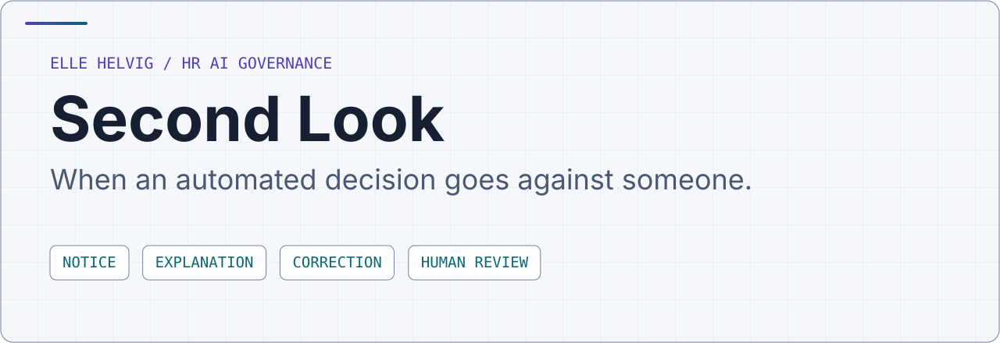
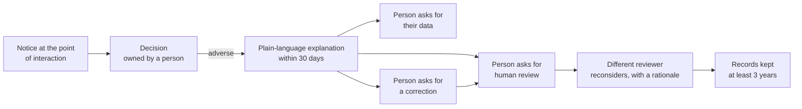

# Second Look

<picture>
  <source media="(max-width: 600px) and (prefers-color-scheme: dark)" srcset="assets/second-look-mobile-dark.svg">
  <source media="(max-width: 600px)" srcset="assets/second-look-mobile-light.svg">
  <source media="(prefers-color-scheme: dark)" srcset="assets/second-look-dark.svg">
  
</picture>

When an automated tool helps make an employment decision that goes against someone, what happens next? Second Look is a small, tested workflow for that moment: notice, a plain-language explanation, a chance to fix wrong data, and a review by a different person.

It is built around Colorado's automated decision-making law (SB 26-189), signed in May 2026 with duties starting 1 January 2027, and it keeps the EU timeline in view. Everything here is fictional. It is a reference design, not a product, and not legal advice.

Current enforcement, court, and rulemaking status were not verified. Counsel should check before relying on these dates.

## The flow



## Rules the code enforces

These are checks in [secondlook/case.py](secondlook/case.py), each with a test, not reminders in a policy document.

- A named person owns every decision. The tool cannot.
- The explanation is built only from the case record, from templates. No model writes it, so it cannot claim more than the record shows.
- A correction must name data the tool actually used, and accepting or declining it needs a reason.
- The reviewer cannot be the person who made the original decision, or the tool.
- A review cannot close while a correction is pending, and its rationale must say how any corrected data was weighed. A one-line sign-off is rejected.
- Deadlines are computed, and anything late is flagged.

## Try it

Python 3.10 or later, standard library only.

```bash
python -m secondlook                        # run the fictional case end to end
python -m unittest discover -s tests -v     # 22 tests
```

The fictional case: a screening tool sorts Jordan Rivera's application into the last group because it read 1 year of SQL instead of 4. Jordan gets the explanation, asks for a correction and a review, and a different recruiter reverses the decision. Read the [generated explanation](docs/example-explanation.md).

## What each step is based on

[docs/requirements-map.md](docs/requirements-map.md) maps each step to the Colorado act's summary and the EU dates, with links to official sources. It also lists what the sources leave open, such as what counts as an adverse outcome and how fast a review must happen. Those are set as organization policy in code, so nobody mistakes a policy choice for a legal requirement.

## What this does not do

- It does not decide whether a tool is covered by any law. Counsel does.
- It does not connect to an applicant tracking system or HR system.
- It does not use real candidate or employee data, and should not.
- It does not reflect the Colorado attorney general's rules, which were not yet published when this was built.

## How this was built

Built with Claude, which wrote the code and tests under my direction. I defined the problem and approve everything published here.

## Author

Elle Helvig. HR and talent strategist, 10+ years in enterprise technology. More work at [ellehelvig.github.io](https://ellehelvig.github.io).
